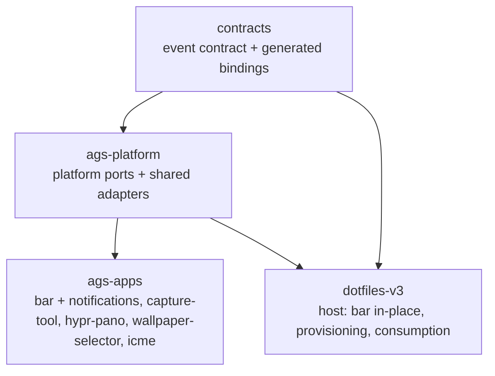

# Architecture Spine — AGS Platform

## Design Paradigm

**Ports-and-adapters (hexagonal).** The platform defines ports; the runtime, the baseline, and the dotfiles host supply interchangeable adapters. This is the paradigm the existing `audio/` module already uses (`application/ports.ts`, `composition.ts`) and the direction doc 99 sets for the repo.

Layer namespaces:

| Layer | Lives in | Contains |
| --- | --- | --- |
| contract | `contracts/` | event contract (XML wire + JSON semantics) + generated bindings/schemas |
| platform ports | `ags-platform/ports/` | `IconProvider`, `EventSource`/`EventHub`, `Notifier`, `Preferences`, `Theme`, `BarContext` |
| platform adapters | `ags-platform/adapters/` | icons, events (the one client), preferences, notifier, theme, baselines |
| bar-specific | `ags-apps/bar/` | `LayoutProvider` (default layout), `SurfaceSpec`/`SurfaceRegistry`/`PopupHost`, the Shell + 4 shapes, capabilities, `bar-manifest.ts` |
| app domain adapters | `ags-apps/<app>/{domains,services}/` | Astal read models (network, battery, bluetooth), the audio hexagon, app services — closed over at registration, **not** carried in `BarContext` |
| apps | `ags-apps/<app>/` | thin consumers; never import each other |

The platform carries **no app-specific policy and no dotfiles paths**. The current reality is pre-port: the real seams are `IconRegistry`, `BarWidgetSpec`, the `overlays` singleton, and `DomainEventBusCore`/`EventBusTransport` — this spine freezes the **target** interface those become.

## Invariants & Rules

### AD-1 — Dependency direction is one-way

- **Binds:** all repos
- **Prevents:** app→app coupling and the version-skew that turns extraction into a rewrite.
- **Rule:** `contracts ← ags-platform ← ags-apps`. An app depends on the platform (and, transitively, contracts); the platform depends on contracts only; **no app imports another app**. The **bar-specific** ports — `LayoutProvider`, `SurfaceSpec`/`SurfaceRegistry`/`PopupHost` — live in the bar app, not the platform.



### AD-2 — Injected context, no module globals

- **Binds:** all AGS code
- **Prevents:** the `overlays` / `registry` / `domainEvents` module singletons that force copy-paste and block testing.
- **Rule:** every cross-cutting capability is a port; runtime dependencies arrive through `BarContext` / provider injection. No module-scope singleton for overlays, icons, events, notifier, preferences, or theme. App-level **domain services** (audio composition binding, battery power service) are closed over **at registration**, never carried in `BarContext`.

### AD-3 — The one rule: meaning vs looks; the state key is the boundary

- **Binds:** all widgets, capabilities, and providers
- **Prevents:** two units inventing incompatible icon/layout vocabularies; the runtime rewriting layout.
- **Rule:** code owns **meaning, behaviour, intent**; data/providers own **looks, presence, delivery**. The **state key** is the only shared vocabulary between them. **Composition** (is a widget in the bar at all) is static config; **visibility** is reactive state (`visible?(state)`). The runtime emits **state, never layout**.

### AD-4 — Frozen platform port surface (doc 101 target, corrected)

- **Binds:** `ags-platform`
- **Prevents:** divergent provider signatures across apps.
- **Rule:** the platform defines exactly these ports; adapters implement them: `IconProvider`, `EventSource`/`EventHub`, `Notifier`, `Preferences`, `Theme`, `BarContext`. Corrections applied to doc 101:
  - `IconRef<S>` gains `fallback?: (variant: string) => IconSource | null`.
  - `EventSource.subscribe(...)` **returns an unsubscribe handle** (today it returns `void`).
  - `IconSource` is a tagged union `{ kind: 'file'; path } | { kind: 'name'; name }` (today `resolve` returns a bare path string).
  - `BarMapping` is **camelCase at the port**; the adapter translates the generated JSON's snake_case (`icon_size`).
  - `OverlayCoordinator` is a named interface minted from today's `overlays` value (`register/isOpen/open/toggle/close/closeAll`).
  - `EventHub.select<T>(topic): Accessor<M[T] | null>` is kept (new machinery; no current implementation).

### AD-5 — One event client

- **Binds:** all event consumers
- **Prevents:** the six hand-rolled readers (four `DomainEventBusCore` copies + two bespoke notification readers) drifting apart.
- **Rule:** one event client — the moved `DomainEventBusCore` plus an injected transport (`EventBusTransport`) — serves every app. **Subscribe-before-read hydration + `(epoch, seq)` dedup lives there.** `control(jobId, action)` is first-class. **The restart/hydration contract is mandatory, not optional:** every consumer resets on `JobsCleared(epoch)` and treats a `(0, 0)` hydration as "no state yet"; no consumer re-implements the state machine or omits the reset.

### AD-6 — The contract is the single source; bindings are generated

- **Binds:** `contracts` + every consumer
- **Prevents:** hand-embedded constants drifting (already observed: `wallpaper.state` ahead of the contract by `stage` and `reload_failures`; the dead `speedtest.finished` in hypr-pano) and a second source of truth.
- **Rule:** `contracts/event-contract.xml` (D-Bus wire) and `contracts/event-contract.json` (methods/signals/topics/delivery) are the **only** source. A generator emits Python + TS bindings and JSON schemas — **including the runtime's wire tables and validation schemas** — and the generated artifacts are **committed into each consumer**. A **regenerate-and-diff gate** fails CI on drift, and it is **symmetric**: the contract is checked against **both** the TS and the runtime tables, not one direction. Versioning is interface-name based: additive stays on `Events1`/`Job1`; removed/retyped/newly-required bumps to `Events2`/`Job2`. **This supersedes AD-44** (the prior owner-accepted no-codegen decision).

### AD-7 — Uniform icon contract

- **Binds:** every icon-bearing widget + provider
- **Prevents:** per-app icon vocabulary drift and missing-glyph crashes.
- **Rule:** code emits a **state key** only; data maps `key → variant → art` through the provider's `bar_mappings.states`. Resolution chain: `provider.barMappings(group)?.states[v] → provider.resolve(group, v)` → `ref.fallback(v)` → blank. Capabilities declare their groups + states; single-glyph groups use an identity fallback. No exceptions (the two current leaks — audio volume/mic, battery power-mode — are migrated in).

### AD-8 — Four widget shapes, one Shell

- **Binds:** bar widgets
- **Prevents:** per-widget re-implementation of gestures, anchoring, tooltip, visibility.
- **Rule:** every widget is one of `DescriptorSpec`, `RichWidgetSpec`, `CollectionSpec`, `ForeignCollectionSpec`, all sharing one `Shell<S>` (`id`, `read`, `tooltip?`, `visible?`, `class?`, `stateClass?`, `pixelSize?`, `primary?`, `secondary?`, `scroll?`). `DescriptorSpec` is realized from today's `BarWidgetSpec`. `popup(...)` and `hub.control(...)` are `BarContext` capabilities, **not** shapes.

### AD-9 — Layout is placement, whole-replacement

- **Binds:** bar composition
- **Prevents:** partial merges producing ambiguous composition; the runtime owning layout.
- **Rule:** a layout provider returns a whole `BarLayout` or null; the first non-null in the chain **user › runtime › repo-default** wins; the **repo default is always non-null**. Layout is placement only; overlays/surfaces follow from capabilities, not layout. A `BarLayout` carries **no version field of its own** — it is versioned by the artifact's `schemaVersion` (AD-16), so there is one versioning scheme, not two.

### AD-10 — Surfaces are factories, mounted lazily

- **Binds:** popups and panels
- **Prevents:** shared-state races (the wifi/bt panels) and the five-times-repeated popup chrome.
- **Rule:** a `SurfaceSpec.body` is a **factory**; hosts mount it only while visible and tear it down when hidden, so at most one overlay is live. Durable state lives in an app-level service. `PopupHost` is the shipped primitive (window + click-catcher + anchor margin + keymode) absorbing all five current popups (AudioPopup, WifiPopup, BatteryPopup, **BluetoothPopup**, SettingsPanel).

### AD-11 — Notifier takes intents

- **Binds:** notification senders
- **Prevents:** senders constructing freedesktop calls or emitting bespoke events; divergent delivery.
- **Rule:** senders post `NotificationIntent`s. The provider routes transient intent → freedesktop `Notify`, keyed/progress intent → the event-card path; both land in the one notifications window. Notification cards remain a **separate concept** (not `SurfaceSpec`) — their expiry/stacking/replace-by-key lifecycle differs.

### AD-12 — Preferences is a port

- **Binds:** cross-app settings
- **Prevents:** each app owning a config file and its own `FileMonitor` (the module-scope-monitor GC trap).
- **Rule:** settings are read through `Preferences.get(namespace, key, fallback) → Accessor<T>`; the adapter owns the file and the monitor lifecycle; an absent file degrades to the fallback.

### AD-13 — Theme is a port

- **Binds:** all UI
- **Prevents:** the three duplicated `theme.ts` copies (byte-identical today) and direct `app.apply_css` calls drifting apart.
- **Rule:** a `Theme` port applies the palette / `colors.gtk.css`; every app routes theming through it. (Doc 101 §11 named theme a shared seam but §4 defined no port; this closes that inconsistency.)

### AD-14 — Capability schema + pure data manifest

- **Binds:** bar capabilities + provisioning
- **Prevents:** a layout referencing unknown widgets/params; the manifest drifting from code; a platform→app code dependency.
- **Rule:** a **pure data** `bar-manifest` (no GJS; a module or emitted JSON) declares capabilities, params, and icon groups. `ParamKind` is recursive; an **unrecognised `type` is a warning, never a crash**. The manifest is **data**: the platform and the validator consume declarations, never app code.

### AD-15 — Two validators, two enforcements, one rule set

- **Binds:** provisioning + bar runtime
- **Prevents:** the same rules enforced differently on the two sides, and a validator that needs runtime objects.
- **Rule:** `validateLayout` and `validateIcons` take the **declarations** (`CapabilityDecl[]` from the manifest) plus the artifact — **not** the runtime `Capability[]` objects (which carry `create`). Provisioning runs both and **fails install on any error**; the bar runs the **same functions** at startup and **degrades** (skip unknown widget, apply defaults, blank a missing glyph). `unknown-param`, `duplicate-widget` (unless `multi: true`), and `missing-icon-key` (only for groups declaring `states`) are errors.

### AD-16 — Provisioning artifacts, versioned per artifact

- **Binds:** runtime ↔ app
- **Prevents:** the two sides parsing each other's internals; two version schemes for one artifact.
- **Rule:** the target producer of the state artifacts (`icons.json`, optional `bar.json` layout override, `colors.gtk.css`) is the **runtime**, each with its own `schemaVersion`. The app declares expectations via the manifest. **The validator is the only place the two sides meet.** An unknown version degrades, never crashes. *Current reality to reconcile:* provisioning generates `icons.json` from committed `icons.yaml` (guarded by `icons-json-drift`), and `bar.json` does not exist yet — the producer relocation and the manifest unification (AD-21) are part of the provisioning step.

### AD-17 — Distribution: one unit, shared ancestor

- **Binds:** deployment
- **Prevents:** per-file enumeration drift (already observed: notifications omits `speedtest-events.ts`) and the framework being unreachable by apps.
- **Rule:** the framework is installed **as one versioned unit** at a **shared ancestor** on every app's resolution path (so `config/ags` **and** every `config/ags-*` resolve it); it is found by a **bare specifier** via a `node_modules` shortcut (resolved by AGS's embedded esbuild, not Node). Provisioning installs it once instead of enumerating files, **and removes the ~200 previously placed per-file copies** it replaces. The shortcut is distinct from the dev-time `ags`/`gnim` built-in aliases. The package boundary (entry point / export shape) is new work — see Open Questions.

### AD-18 — Works with nothing (baselines)

- **Binds:** all
- **Prevents:** the bar requiring the runtime to run.
- **Rule:** repo-default layout, a symbolic `IconProvider` + capability fallback, `NoEventSource`, and a freedesktop/noop notifier. The bar runs on a bare desktop with no runtime, no `icons.json`, no hub.

### AD-19 — Gate discipline

- **Binds:** all repos
- **Prevents:** a bad extraction passing CI (today `bar-typecheck`/`ags-typecheck`/`capture-typecheck` are excluded from `gates-ci`; `ags-typecheck` only fails under `audio/`; `ags-typecheck` runs only on a self-hosted CI job).
- **Rule:** before extraction begins, `bar-typecheck` and `ags-typecheck` must cover the extracted surface and run in `gates-ci`; the per-app drift/symbol suites run in the root gate. Every migration step leaves the tree green.

### AD-20 — Sequenced migration

- **Binds:** the split
- **Prevents:** big-bang changes and creating repos from untested code.
- **Rule:** extract the platform **in-place in dotfiles-v3 first**, prove it with the existing gates, then publish. Integrate **contracts → platform → apps**. Parallel authoring is allowed **only against this frozen spine**. Doc 101 §13.1–7 fold in as in-place prerequisites.

### AD-21 — One icon manifest, one owner, one shape

- **Binds:** icon provider + provisioning
- **Prevents:** the manifest having three owners and two shapes (the bar's build-time bundled `icons.json` with no `schemaVersion`; the apps' runtime file; provisioning's generated copy), so `bar_mappings.states` goes stale against the rendered set.
- **Rule:** there is exactly one icon manifest artifact and one schema. The bar's build-time import is a **bundling detail of the same artifact**, not a second source. The single manifest carries `schemaVersion` (AD-16) and is the only thing `IconProvider.barMappings` reads.

### AD-22 — One producer per topic

- **Binds:** event topics
- **Prevents:** two producers for one topic (today `speedtest.state` is emitted by both the runtime's `speedtest.py` and the bar's `speedtest-service.ts`), which makes "exactly one done/error per run" unenforceable and violates AD-3.
- **Rule:** each topic has **exactly one producer**; the runtime is the sole producer for the topics it owns. An app that needs to trigger a run calls a runtime capability; it does not emit the topic itself.

### AD-23 — Operational envelope

- **Binds:** all repos + deployment
- **Prevents:** a whole dimension (CI, environments, credentials, how a fresh host is provisioned) left silent while AD-6/AD-17/AD-19 name CI that is never defined.
- **Rule:**
  - **Environments:** local development in `dotfiles-v3` worktrees; CI on GitHub Actions — a stock runner for pure gates and a **self-hosted linux runner** for desktop-stack typechecks.
  - **CI per repo:** `contracts` runs the codegen regenerate-and-diff + schema validation; `ags-platform` runs typecheck + tests; `ags-apps` runs typecheck + the per-app drift/symbol suites. Each repo gates on its own `Makefile` target.
  - **Fresh host:** provisioning installs the pinned framework unit, creates the shortcut, and runs `ags-bar-validate`; private repos are fetched over HTTPS with the `gh` credential helper (no SSH).
  - **Versioning/rollback:** the framework unit is versioned by directory; rollback repoints the shortcut (mechanism = Open Question).

### AD-24 — Overlay/surface open path: surface before content

- **Binds:** all surface/overlay apps (any layer-shell window that maps/unmaps on demand)
- **Prevents:** a `map` handler that builds heavy content **synchronously before the surface is presented** — the first frame cannot land until the whole build finishes — and a full rebuild on every reopen even when the content is unchanged. Measured on hypr-pano's 141-item clipboard history: `map → first frame` 447–504 ms, of which the card rebuild was 426–451 ms (`readHistory` only 0.3–0.6 ms).
- **Rule:** the open path is **four moves, in order:**
  1. **present** — put the surface on screen (and take focus) first, before any heavy work;
  2. **hydrate** — the cheap synchronous pass (read the source, set visibility, move the highlight) that MUST NOT construct or tear down heavy widgets;
  3. **defer** — schedule the heavy build on an **idle callback**, off the map→first-frame path;
  4. **skip + re-check** — skip the deferred build when the **content signature** is unchanged since the last build, and re-check staleness *inside* the callback (a keystroke or a live push may have changed — or already rebuilt — the content between map and idle, and an unmap cancels it).

  The controller is created **once per surface** (per monitor) and outlives a map/unmap cycle; `close()` MUST NOT clear the remembered signature, so an unchanged reopen is the warm path.
- **Mechanism (mandated):** the platform primitive is the required implementation — `overlayLifecycle(hooks)` (the GLib-bound convenience) or `createOverlayLifecycle(hooks, scheduler)` (the pure, injected core), plus `contentSignature(parts)`, exported from `ags-platform` (`ports/overlay-lifecycle.ts`, `adapters/overlay-lifecycle.ts`). This is AD-2/AD-4 spirit applied to surfaces: **one primitive, injected, no copy-paste** — an app supplies the four effects (`present`, `hydrate`, `build`, `key`); the core owns their order and the skip/defer decision.
- **Evidence:** proven in `ags-apps` hypr-pano (`725ffdf`): same history and instance, `map → first frame` **5.5 ms cold** (the ~440 ms rebuild now runs after the surface is up) and **~1.0 ms warm** with no rebuild. *Honest caveat: this fixes **time-to-surface**, not time-to-content — the heavy build still runs; chunking or virtualizing it is a separate per-app concern.*

## Consistency Conventions

| Concern | Convention |
| --- | --- |
| Naming — ports | `<Thing>Provider` / `<Thing>Source` (e.g. `IconProvider`, `EventSource`, `LayoutProvider`, `Notifier`, `Preferences`, `Theme`). |
| Naming — capabilities / widgets | kebab-case stable ids (`network`, `power-menu`, `audio-output`). |
| Naming — state keys | `<domain>-<qualifier>` (`wifi-full`, `volume-medium`, `charging-75`); single-glyph groups use identity. |
| Naming — event topics | `<domain>.<event>` (`capture.state`, `wallpaper.state`). |
| Data & formats — event contract | XML = wire source of truth; JSON = semantics; versioned by interface name (`Events1`/`Job1`). |
| Data & formats — port vs artifact | `BarMapping` is camelCase at the port; the generated JSON is snake_case; the adapter translates. |
| Data & formats — artifacts | each artifact carries its own `schemaVersion`; a `BarLayout` has no separate version field; unknown version degrades. |
| State & cross-cutting — injection | `BarContext` injected; no module globals (AD-2). |
| State & cross-cutting — mutation | only the runtime changes state; apps render; one producer per topic (AD-3, AD-22). |
| State & cross-cutting — errors | validator reports `BarIssue{severity,code,...}`; runtime degrades, install fails. |
| State & cross-cutting — config | through the `Preferences` port, never a direct file read (AD-12). |

## Stack

| Name | Version |
| --- | --- |
| AGS | 3.1.2 host (`aylurs-gtk-shell-git`) — **unpinned**; CLI self-reports 3.1.0 |
| esbuild | AGS-embedded v0.25.10 (the bare-specifier resolver) |
| GNIM | 1.9.1 (bundled by AGS) |
| Astal | separate `libastal-*` AUR libs — **unpinned** |
| TypeScript | 5.9 (repo pin in the gate targets; not current — Open Question) |
| Python runtime | 3.14 (uv-managed) |
| Test runner (AGS) | Node built-in `node --test` (no vitest/jest) |
| Distribution | GitHub (private repos) via `gh`, HTTPS credential helper |

## Structural Seed

Deployment shape (one unit, shared ancestor — every `config/ags*` resolves it):

```text
<install>/                         # $XDG_DATA_HOME/dotfiles  (~/.local/share/dotfiles)
  ags-platform/<version>/          # the framework, installed as one unit
  config/
    node_modules/ags-platform -> ../../ags-platform/<version>   # shared ancestor
    ags/            # the bar      (-> ~/.config/ags)
    ags-capture/    # capture-tool (-> ~/.config/ags-capture)
    ags-notifications/ ...         # (-> ~/.config/ags-notifications)
    ags-hypr-pano/ ags-wallpaper-selector/ ags-icme/
```

Target source tree:

```text
contracts/
  event-contract.{xml,json,md}
  schemas/
  gen/                      # the generator + regenerate-and-diff check
  generated/                # contract.py, contract.ts, *.schema.json
ags-platform/
  ports/                    # IconProvider, EventSource/EventHub, Notifier,
                            #   Preferences, Theme, BarContext
  adapters/                 # icons, events (the one client), preferences, notifier,
                            #   theme, baselines (symbolic icons, NoEventSource, ...)
ags-apps/
  bar/                      # LayoutProvider default, SurfaceSpec/SurfaceRegistry/PopupHost,
                            #   Shell + 4 shapes, capabilities, bar-manifest.ts
    domains/ services/      # network/battery/bluetooth read models, audio hexagon (app adapters)
  notifications/ capture-tool/ hypr-pano/ wallpaper-selector/ icme/
dotfiles-v3/
  dotfiles/config/ags/      # in-place extraction bridge, then consumed from the platform
  src/provisioning/         # installs the framework as one unit; runs ags-bar-validate
```

## Capability → Architecture Map

Doc 101 §13 steps mapped to where they land and what governs them:

| Area | Lives in | Governed by |
| --- | --- | --- |
| Kit completeness (`stateClass`, rich `content`, `IconRef.fallback`) | platform + bar shapes | AD-4, AD-7, AD-8 |
| Reactive domain read models (network, battery, bt, audio) | app domain adapters | AD-2, AD-3 |
| Uniform icon contract (audio/battery leaks) | platform + capability decls | AD-7, AD-21 |
| Hub consumer + job control | platform event client | AD-5, AD-6 |
| Surfaces + `PopupHost` | bar-specific | AD-10 |
| Shapes (tray/workspaces/clock) | bar-specific | AD-8 |
| Preferences + Notifier + Theme | platform adapters | AD-11, AD-12, AD-13 |
| Contract + codegen | contracts | AD-6 |
| In-place extraction | dotfiles-v3 | AD-20, AD-19 |
| Publish platform + apps | ags-platform, ags-apps | AD-1, AD-17, AD-23 |
| Provisioning + validator | dotfiles-v3 / platform CLI | AD-15, AD-16, AD-17 |
| Deletion of duplicates | dotfiles-v3 | AD-20 |

## Deferred

- **Per-app repo split** — deferred; `ags-apps` stays one repo until the platform boundary is stable.
- **Notification cards as surfaces** — kept a separate concept (AD-11); revisit only if the lifecycle unifies.
- **`ForeignCollectionSpec` naming** — kept as its own shape (AD-8).
- **`bar.json` layout override** — the artifact does not exist yet; the layout chain (AD-9) is defined but the runtime override is future work.
- **`Events2` operational mechanism** — the policy is fixed (AD-6); no `Events2` implementation exists and none is required until a breaking change.
- **The `wallpaper.state` contract gap** — folded into the contracts codegen work (AD-6), not fixed here.

## Open Questions

- **Package boundary + Node type-stripping** — AD-17 assumes a `node_modules` bare specifier, but no `package.json`/export shape exists yet, and Node v26 rejects `.ts` under `node_modules` (`ERR_UNSUPPORTED_NODE_MODULES_TYPE_STRIPPING`) while the test setup uses `node --test` with native type stripping. Decide the platform's shipping shape (AGS/esbuild consumes it; how tests import it). Revisit condition: before the extraction (AD-20) starts.
- **AGS / Astal version pinning** — the resolution mechanism assumes a stable AGS; both `aylurs-gtk-shell-git` and `libastal-*` are unpinned AUR git packages. Revisit condition: before the distribution rework (AD-17) ships.
- **TypeScript pin** — the repo pins 5.9 in the gate targets; current is materially newer. Confirm the pin is deliberate. Revisit condition: before extraction.
- **Framework unit versioning & rollback** — the `<version>` directory is the intended shape (AD-17/AD-23) but no provisioning logic pins, switches, or rolls back a version yet. Revisit condition: at the provisioning step.
