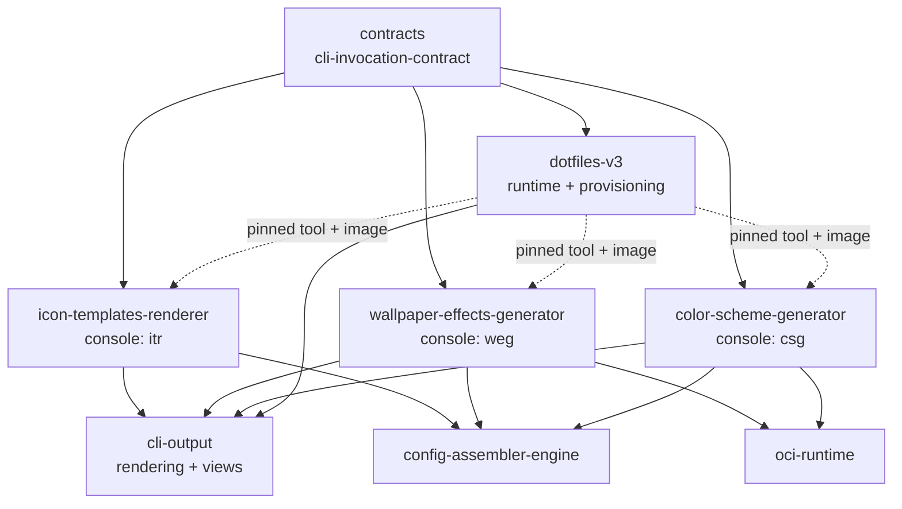
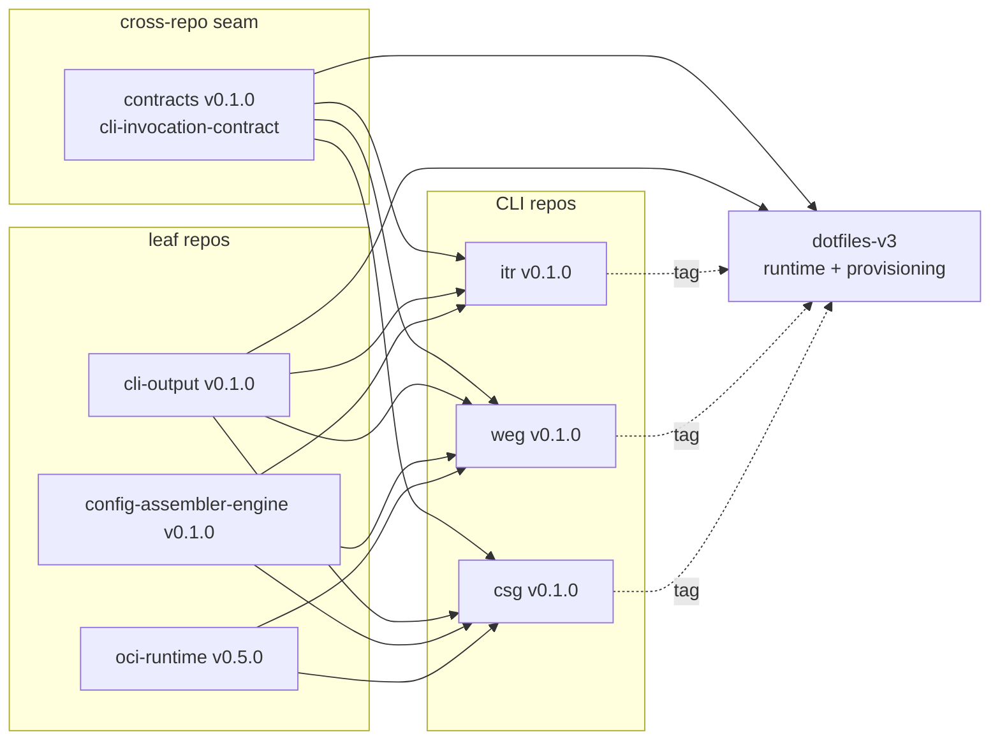

# Architecture Spine — CLI and shared-library repo split

## Design Paradigm

**Hexagonal packages on a pinned-artifact supply chain.** Each package keeps its existing
ports-and-adapters internals (validated today by `test_layering.py` in runtime and provisioning).
The new decision is the *supply chain*: every package is a leaf repo that publishes immutable tags,
and every dependency edge crosses a repo boundary as a pinned version, never as a filesystem path.

| Layer | Lives in | Contains |
| --- | --- | --- |
| shared libs (leaves) | `cli-output`, `config-assembler-engine`, `oci-runtime` repos | ports, domain, adapters; no sibling-repo dependency |
| CLIs | `icon-templates-renderer`, `wallpaper-effects-generator`, `color-scheme-generator` repos | console scripts `itr`, `weg`, `csg`; depend on libs and on the pinned contract package |
| host / consumer | `dotfiles-v3` | runtime (`dotfiles-runtime`), provisioning, desktop config; consumes CLIs as pinned tools + images |
| contract | `contracts` repo (package `cli_invocation_contract`) | the runtime↔CLI invocation contract + conformance kit, alongside its existing AGS event contract |

The split does **not** change runtime internals: the runtime already couples to the CLIs only by
subprocess, exit status, artifact filenames and hashes (`S1` §0 facts 1–7; §2.1–2.2).

## Inherited Invariants & Constraints

These are binding inputs, not re-derived here.

| Inherited | From | Binds here |
| --- | --- | --- |
| Evidence rule: every non-trivial claim carries a command + observed result, or a file path + line range | `dotfiles-v3/AGENTS.md` §3; `mu/AGENTS.md` §1 | every gate and every Verify line in `SLICES.md`; `EVIDENCE-INDEX.md` |
| Never work on `master`; work in `.worktrees/<id>/`; merge only on green gates | `dotfiles-v3/AGENTS.md` §1; `mu/AGENTS.md` §2 | each slice's branch and entry criteria |
| Planning edits and code changes land in separate commits | `dotfiles-v3/AGENTS.md` §4 | extraction repos are imported by a code-only commit; this spine is a planning-only commit |
| One unit, one gate; consume external units whole, pinned by tag | `docs/LESSONS-ags-apps-migration.md` §5; `docs/101-ags-platform-architecture.md` §3 | AD-3, AD-10, AD-11 |
| Retire a gate by deleting it, never by leaving it pointing at a tree the repo no longer owns | `docs/LESSONS-ags-apps-migration.md` §5 | AD-14 |
| Gates move with the code | `docs/GUIDE-ags-app-repos-refinement.md` §7 | AD-12, AD-14 |
| Fixed by the human: dependency direction, sequential loop, mu-strict birth, evidence-or-OPEN | run constraints (memlog entries 1–5) | AD-1, AD-12, AD-13 |

## Invariants & Rules

### AD-1 — Dependency direction is one-way and acyclic

- **Binds:** all six repos + dotfiles-v3
- **Prevents:** CLI→CLI coupling, runtime importing a CLI, and the version skew that turns a split into a rewrite.
- **Rule:** `cli-output`, `config-assembler-engine`, `oci-runtime` depend on no sibling repo. The three CLIs depend on libs and on the pinned `cli_invocation_contract` package (AD-4) only. `dotfiles-v3` consumes CLIs and libs as pinned artifacts. No CLI imports or invokes another CLI; no runtime module imports a CLI package; no repo declares a uv workspace over another repo.



### AD-2 — One package per repo; repo root is the package root

- **Binds:** all six repos
- **Prevents:** the split reproducing `src/cli-tools` + `src/shared` inside a repo, which would recreate the monorepo assumption the split exists to remove.
- **Rule:** each repo has exactly one `pyproject.toml` at its root and one import package at `src/<import_name>/`. Tests at `tests/`. Container assets at `src/<import_name>/adapters/docker/` for csg/weg only. No nested project roots, no second `openspec/` root inside the source tree.

```text
<repo>/
  AGENTS.md   CLAUDE.md -> AGENTS.md   README.md   CHANGELOG.md   Makefile
  pyproject.toml   uv.lock
  src/<import_name>/           # domain / ports / adapters
  tests/                       # unit / integration / architecture + conftest.py
  docker/                      # csg, weg only: the build-context-relative assets
  openspec/                    # config.yaml + specs/ + changes/
  tickets/                     # INDEX.md, LIFECYCLE.md, _template/, _fixtures/
  scripts/worktree-guard.sh
  .agents/skills/   skills-lock.json   _bmad/
  .github/workflows/gates.yml
```

### AD-3 — Consumption is by immutable tag only

- **Binds:** every consumer edge
- **Prevents:** editable path installs that die when the checkout moves (`S2` §2.3: `.pth` and `direct_url.json` point into the checkout), and lock-free drift.
- **Rule:** a dependency on a sibling repo is declared as a git source at a tag (`{ git = "https://…/<repo>", tag = "vX.Y.Z" }`) plus a compatibility range in `[project].dependencies`; `uv.lock` is committed and records the resolved commit. No `path =`, no `editable = true`, no submodule, no cross-repo workspace. A published tag is never moved or deleted; a fix is a new tag.

### AD-4 — `contracts` owns the runtime↔CLI invocation contract; `cli-output` stays presentation-only

- **Binds:** runtime adapters, all three CLIs, the `contracts` Python package, provisioning pins
- **Prevents:** each side testing its own literals — argv shape, env key, exit code, artifact filenames and hashes drift silently (`S1` §6.1 shows those literals duplicated per adapter); and a rendering package acquiring a charter it was not designed for.
- **Rule:** the `contracts` repo (`/home/inumaki/Development/contracts`) owns the invocation contract as versioned data plus a conformance kit. Per CLI the record carries: argv template, required env keys, required artifact names/suffixes, exit-code semantics, default timeout. The kit exposes exactly two assertions: (1) a consumer's recorded invocation matches the record; (2) the CLI accepts the recorded invocation and writes the required artifacts. `cli-output` remains **presentation-only** (rendering + views) and its charter is unchanged; it neither hosts nor imports the contract. The contract ships from a Python package in `contracts`: distribution `cli-invocation-contract`, import package `cli_invocation_contract`, kit at `cli_invocation_contract.testkit`, data in `invocation-contract.json` (one entry per CLI). That package is **new work in `contracts`** — the repo has no `pyproject.toml` and zero tags today — and is done in its own worktree/ticket under that repo's `AGENTS.md` (`bash scripts/worktree-guard.sh create <id> <slug>`, never on `main`, routing via `tickets/` + `openspec/`). The dotfiles runtime and **all three CLIs** pin the **same `contracts` tag** — not merely a compatible range — and that equality is asserted at provision time (AD-11). Changing the contract requires a new `contracts` tag that every consumer re-pins in the same slice. Contract data is not duplicated in either side's tests.

### AD-5 — A container image builds from its own repo root

- **Binds:** csg, weg, their Dockerfiles, image build verbs
- **Prevents:** `COPY src/cli-tools/...` and `COPY src/shared/...` requiring a root that no longer exists (`S2` §2.3; `S4` §2.5), and the `_REPO_MARKER_DIRS` failure proven in `S2` §2.3.
- **Rule:** the build context of `csg` and `weg` images is the checkout of that CLI repo. Dockerfiles `COPY` only paths inside that repo (`pyproject.toml`, `uv.lock`, `src/`). Shared libs enter the image from the same tags the repo lock pins; the build stage carries `uv` at the pinned version plus `git` and CA certificates, because pinned git dependencies are fetched at build time — determinism comes from tag + locked commit, and an unreachable pin fails the build closed rather than resolving something newer. No Dockerfile may reference a sibling repo or a parent directory.

### AD-6 — `oci-runtime` replaces the monorepo locator with a repo-root locator

- **Binds:** `oci-runtime`, `csg install`, `weg install`, provisioning's image-build task
- **Prevents:** `resolve_source_root` requiring `src/cli-tools` **and** `src/shared` under one root (`source_locator.py:37-39`), which rejects every post-split checkout.
- **Rule:** new API `resolve_build_context(*, package, override=None, env_var=None, env=None) -> BuildContextRoot`, whose marker is a directory containing `pyproject.toml` **and** `src/<import_name>`; the same four-source priority order is kept (override → env → PEP 610 → package walk). `resolve_source_root` stays exported as a deprecated alias for one minor and accepts either marker set, so in-tree consumers keep working through the migration. The CLI flag `--source-root` remains as an alias of `--context`. The locator is required only by the image-build verb — no run-time path depends on a checkout.

### AD-7 — Image build ownership is split between the CLI repo and provisioning

- **Binds:** csg, weg, `roles/cli_tools`, `roles/settings` (renders `image_tag`)
- **Prevents:** two owners of one Dockerfile, and a consumer inventing build arguments the CLI does not support.
- **Rule:** the CLI repo owns its Dockerfiles and the build verb (`<cli> install --context <checkout> --container-engine <engine>`; `itr` has no container mode and no build verb). `dotfiles-v3` provisioning owns the pin, the shallow clone at that tag, the install invocation, and the post-build verification that the expected image exists. Provisioning never writes or patches a Dockerfile. **The image tag is the pin, not `latest`:** the rendered `image_tag` equals the pinned repo tag (`vX.Y.Z`), the build verb accepts it, and `verify` asserts the image exists at that exact tag — so a pin bump can never silently reuse the previous image.

### AD-8 — Test suites are hermetic by construction

- **Binds:** all six repos' `tests/`, dotfiles' extraction-adjacent suites
- **Prevents:** the observed failures where a provisioned spine wins over the packaged default (`S3` §5.1: csg `test_resolve_falls_back_to_package_defaults`, itr `test_resolves_bundled_default`), and the false green when the host happens to have no `~/.config/<tool>`.
- **Rule:** every suite passes with `HOME` and `XDG_CONFIG_HOME`/`XDG_CACHE_HOME`/`XDG_DATA_HOME`/`XDG_STATE_HOME` pointed at empty temporary directories and with an unrelated working directory. Enforcement is an autouse fixture in `tests/conftest.py` per repo (set the five variables, `chdir` to a temp dir) plus a CI invocation under a scrubbed environment and a canary test asserting the fixture is active. Fixes go in tests, never in the resolvers: `S3` §1.4 / §5.4 show XDG-over-default precedence is the intended production behavior.

### AD-9 — One release ritual, semver tags, artifacts on the tag

- **Binds:** all six repos; every consumer pin bump
- **Prevents:** a tag whose content cannot be reconstructed, and “latest” pins (`S1` §4.5 shows `image_tag = "latest"` and unversioned `uv tool install` today).
- **Rule:** a release is: gates green on the ticket branch → version bumped in `pyproject.toml` + `CHANGELOG.md` → annotated tag `vMAJOR.MINOR.PATCH` → CI builds sdist and wheel and attaches them to the GitHub Release → consumer pin bump in its own commit. First tags: `contracts v0.1.0` (first tag in that repo; ships `cli-invocation-contract` 0.1.0 with the invocation contract and kit), `cli-output v0.1.0` (version continuity with the in-tree 0.1.0; it no longer carries the contract), `config-assembler-engine v0.1.0`, `oci-runtime v0.5.0` (the imported code is 0.4.0; the build-context API ships in the first tag, so versions never move backwards), `csg`/`weg`/`itr` `v0.1.0`. PyPI publication is not part of this design. Rollback is a pin bump to the previous tag, never a retag.

### AD-10 — Provisioning addresses tools by `{name, repo, tag}` and assets by the checkout

- **Binds:** `dotfiles/provisioning/cli-tools.yaml`, `dotfiles/provisioning/assets.yaml`, `roles/cli_tools`, `roles/assets`, `roles/verify`
- **Prevents:** dead `source:` paths (`S2` §7.1 items 1–4) and asset copies from a deleted tree (`S2` §7.2 items 6–8).
- **Rule:** `dotfiles/provisioning/cli-tools.yaml` is the single source of truth. Every CLI entry carries `name`, `repo`, `tag`; no `source:` key. The role shallow-clones `repo@tag` into `<install>/cli-tools/<name>/<tag>/`, removes `.git`, writes a `pinned` record, and installs the tool **from that checkout** (not from the git URL), so PEP 610 records a tag-bearing path. Checkout materialization is an explicit `fetch` task list that any asset step reading a checkout depends on, so `role/assets` cannot run before the tree it copies from exists. Asset entries that today read a package tree (notably `csg-templates`) read the same pinned checkout path instead. The runtime's dev-only `src/cli-tools/...` input fallbacks are deleted in the slice that deletes the tree.

### AD-11 — Pins are asserted by execution, and the shape by one gate

- **Binds:** `roles/verify`, `scripts/deploy-coverage.py`, provisioning tests
- **Prevents:** a green `command -v` hiding a wrong-tag install (`S2` §3: `verify` has no pin assertion for the CLIs, unlike the `ags-apps` capture-tool precedent at `S2` §5.4).
- **Rule:** `verify` carries independent literal pins mirroring the role (manual manifest is authoritative, role and verify mirror it, and a parity test asserts all three agree). It asserts the checkout path contains the tag, the installed package version equals the tag with the leading `v` stripped, the contract version reported by each CLI equals the `contracts` tag pinned by `dotfiles-v3` (and by the CLI's own repo — one tag, four consumers), and the expected image exists **at the tag-qualified image tag** for container-mode CLIs. `deploy-coverage` asserts: every entry has `repo` and `tag` (and, once the last CLI slice lands, no `source:` key at all); role vars, manifest and verify pins agree; the retired trees do not exist; no `path =`/`editable = true` pin remains in any `pyproject.toml`. Strict `source:`-absence is staged: per-entry while the manifest is mixed, catch-all after the last CLI slice.

### AD-12 — Repo birth is mu-strict, from the first commit

- **Binds:** each new repo at creation time
- **Prevents:** “harness later”, which `docs/GUIDE-ags-app-repos-refinement.md` §7 names as the reason per-app splits were deferred.
- **Rule:** a repo is not a valid extraction target until the birth checklist (§ Repo Birth Checklist) is present and its gates run green on a fresh clone. Harness files are copied from `mu` (same `skills-lock.json` hashes, same `worktree-guard.sh`), not re-authored.

### AD-13 — Migration is destructive-last

- **Binds:** every slice
- **Prevents:** deleting the only working copy before the replacement is proven, and leaving dead references behind after deletion.
- **Rule:** per target, in this order: create repo + import + tag → rewire dotfiles consumption to the pin → prove the new wiring by execution → delete the in-tree copy **in the same slice** (tree, repo-relative runtime fallbacks, asset/manifest sources, `.gitignore` entries, prose that names it) → merge. The next target starts only after the merge. Rollback is the pin plus a revert of the deletion commit; the deleted tree is recoverable from the merge base.

### AD-14 — Tests move with their code and are gated there

- **Binds:** the six packages' test suites, `Makefile` gate set
- **Prevents:** the current state where no gate runs any of these suites (`S4` §1.1: zero references in `Makefile`, `scripts/`, CI; `make gates-ci` runs five gates, none of them these).
- **Rule:** the **195 tracked `test_*.py` files** move with their packages (per package: csg 49, weg 30, itr 32, cli-output 8, config-assembler-engine 16, oci-runtime 60) and run in that repo's `make gates` and CI. `dotfiles-v3` runs none of them and asserts the trees are gone. The retired-gate rule applies: no dotfiles gate may point at a moved suite.

### AD-15 — OpenSpec ownership follows code ownership

- **Binds:** `openspec/` (dotfiles root) and `src/cli-tools/openspec/`
- **Prevents:** a spec that describes code in another repo becoming a second, stale source of truth (`S4` §1.6: 590 hits, 147 files).
- **Rule:** a spec whose subject is one package moves to that package's repo. Cross-package specs that describe the CLI↔runtime boundary (`interface-contract-test`, `container-adapter-env-contract`) move to `contracts` with the invocation contract (S0a/S0b), because the record they describe lives there. The nested `src/cli-tools/openspec/` (one csg-only change plus a placeholder spec) moves to the csg repo's `openspec/changes/archive/`. `openspec/changes/archive/**` stays in `dotfiles-v3` as immutable history with a pointer note; it is never migrated or rewritten.

### AD-16 — Backward compatibility is behavioral, not layout-preserving

- **Binds:** installed tools, provisioning upgrade path, runtime adapters
- **Prevents:** claiming old installs keep building images after the layout they depend on is gone.
- **Rule:** an installed pre-split CLI keeps **running** — the runtime needs only `PATH`, the env allowlist, and writable output dirs (`S1` §1.5, §3.3, §5). It cannot **build images** from a post-split checkout because its marker set no longer exists; that path fails loudly with `SourceRootNotFoundError` (`S2` §2.3), which is the intended no-stale-image behavior. The next bootstrap replaces it via the pinned install. The `--source-root` flag and `resolve_source_root` symbol remain for one minor as aliases. The compatibility window ends when the last in-tree copy is deleted.

## Consistency Conventions

| Concern | Convention |
| --- | --- |
| Repo / package / console names | unchanged for the six: `cli-output`, `config-assembler-engine`, `oci-runtime`, `color-scheme-generator` (`csg`), `wallpaper-effects-generator` (`weg`), `icon-templates-renderer` (`itr`); contract repo `contracts`, package `cli-invocation-contract` / `cli_invocation_contract` (new) |
| Tag format | annotated `vMAJOR.MINOR.PATCH`, one package per repo, monotonic, never moved |
| Branch / worktree | `ticket/<id>-<slug>` in `.worktrees/<id>/`, created by `scripts/worktree-guard.sh` |
| Commits | planning vs implementation separate; one extraction = import commit + pin commit + deletion commit |
| Env contract | existing prefixes unchanged: `COLORSCHEME__`, `WALLPAPER__`, `ICON_RENDERER__`; the runtime allowlist is the boundary (`env.py:22-87`) |
| Artifact contract | existing filenames and hashes unchanged (`S1` §2.2); the record in `contracts` (`invocation-contract.json`) is the single source |
| Settings discovery | unchanged CLI-side order: `--config` → env → cwd traversal → XDG → packaged default (`S3` §0); provisioning keeps the XDG symlink model |
| Errors / exit codes | unchanged: non-zero exit with stderr preserved; `itr` permission branch stays `PermissionError` until the contract records it (`S1` §2.4) |
| Docs | each repo README states its public surface + how dotfiles pins it; no doc names a path in another repo |
| Evidence | every repo `AGENTS.md` carries the Evidence + Verify rule verbatim from `mu` |

## Stack

| Name | Version |
| --- | --- |
| Python (packages) | `>=3.12` (unchanged in all six `pyproject.toml`) |
| Python (container base) | `python:3.14-slim` (csg), `python:3.14-alpine` (weg) |
| Build backend | `hatchling` (existing) |
| uv | `0.9.22` (host-observed; pinned in CI and in image builds) |
| pytest | `>=8.0` |
| ruff | `>=0.15` |
| typer / pydantic / rich / pyyaml | existing floors unchanged (`typer>=0.12`, `pydantic>=2.0`, `rich>=13.0`, `pyyaml>=6.0`) |
| CI runner | GitHub Actions `ubuntu-latest` + `actions/checkout`, per-repo `gates.yml` |

No new framework or library is introduced; versions are read from the current tree (brownfield), not
re-verified on the web. `uv 0.9.22` is host-observed (`uv --version` in `S2` §2.3). The two uv
commands the slices rely on were checked against the current docs: `uv lock --check` (fails when the
lockfile is stale) and `uv tool install git+<url>@<tag>` (tag pin syntax), both at
`docs.astral.sh/uv` (`guides/tools`, `concepts/projects/sync`).

## Structural Seed

### Dependency and supply chain



### Provisioned layout after the split

```text
<install>/                          # XDG_DATA_HOME/dotfiles
  cli-tools/
    csg/<tag>/                      # shallow clone, .git removed, `pinned` record
    weg/<tag>/
    itr/<tag>/
  config/
    color-scheme-generator/         # csg-settings.toml + templates (copied from the csg checkout)
    weg/                            # weg-settings.toml + effects.yaml
    itr/                            # itr-settings.toml
  icon-templates/  icon-mappings/
~/.config/<tool> -> <install>/config/<tool>
~/.local/bin/<csg|weg|itr> -> ~/.local/share/uv/tools/...   # uv tool env, installed from <install>/cli-tools/<name>/<tag>
```

### CI topology per repo

```mermaid
graph TD
  PR["push / pull_request"] --> G["make gates"]
  G --> T["make test (hermetic env)"]
  G --> L["make lint"]
  G --> H["make hermetic-canary"]
  G --> P["make ci-gates-parity"]
  TAG["tag vX.Y.Z"] --> R["release job: uv build + GitHub Release assets"]
```



## Per-Repo Contracts and Boundaries

| Repo | Owns | Public surface | Consumes | Must not |
| --- | --- | --- | --- | --- |
| `contracts` | the runtime↔CLI invocation contract (data + `cli_invocation_contract.testkit`) alongside its existing AGS event contract | `cli_invocation_contract` package, `invocation-contract.json` | none (stdlib only) | render UI; know a CLI’s argv beyond the record |
| `cli-output` | rendering ports/adapters (presentation only) | `cli_output` package | `rich` only | host the invocation contract (AD-4); import a sibling package; know a file path in another repo |
| `config-assembler-engine` | resolution strategies, config assembly | `config_assembler_engine` package | `pydantic`, `pyyaml` | know a tool’s XDG subdir or settings filename |
| `oci-runtime` | container engine abstraction, build/run/exec, build-context locator | `oci_runtime` package incl. `resolve_build_context` | none | ship a Dockerfile; know a CLI’s build flags |
| `icon-templates-renderer` | `itr render`, template/mappings discovery | console `itr`; settings schema | `cli-output`, `config-assembler-engine`, `contracts` | depend on `oci-runtime`; invoke another CLI |
| `wallpaper-effects-generator` | `weg batch`, catalog/effects, image build | console `weg`; `image build`/`install`; Dockerfiles | `cli-output`, `config-assembler-engine`, `oci-runtime`, `contracts` | read a dotfiles path; COPY a sibling repo |
| `color-scheme-generator` | `csg generate`, templates, backend images | console `csg`; `image build`/`install`; Dockerfiles + template defaults | `cli-output`, `config-assembler-engine`, `oci-runtime`, `contracts` | read a dotfiles path; COPY a sibling repo |
| `dotfiles-v3` (host) | runtime, provisioning, desktop config, pin policy | `dotfiles-runtime`; Ansible roles; `cli-tools.yaml` | six pinned tags + one `contracts` tag | import or vendor a CLI/lib tree; run their tests |

## Resolved Hard Problems

| # | Problem | Decision | Consequences | Evidence |
| --- | --- | --- | --- | --- |
| 1 | Container build topology | AD-5 + AD-6 + AD-7 + AD-10: context is the CLI repo checkout; new `resolve_build_context` marker (`pyproject.toml` + `src/<pkg>`); CLI repo owns Dockerfiles/verb, provisioning owns pin/clone/trigger; `--source-root` kept as alias, `resolve_source_root` deprecated for one minor | Dockerfiles lose all `src/shared`/`src/cli-tools` COPY lines; images are built at provision time from `<install>/cli-tools/<name>/<tag>`; registry publication deferred; old installed tools can run but not build (AD-16) | `S2` §2.3, §7.1 items 5, 12, 13; `S4` §2.5–2.6; `source_locator.py:37-39,109-144`; `Dockerfile.base:3-7`; `Dockerfile.imagemagick:9-19` |
| 2 | Test hermeticity | AD-8: rule at the test layer (autouse fixture + canary + scrubbed CI env), fixed in-tree **before** the first extraction (slice S0b); resolvers untouched | The two known failures disappear without weakening the intended XDG precedence; every extracted suite is green on first run in its new repo; CI cannot inherit a developer’s spine | `S3` §5.1 (observed failures + pass with empty XDG), §1.4, §5.4 |
| 3 | Contract ownership | AD-4: contract data + conformance kit live in the `contracts` repo (package `cli-invocation-contract`); every consumer pins the same `contracts` tag and executes the kit; `cli-output` stays presentation-only | `cli-output`’s charter is unchanged; `contracts` gains a `pyproject.toml` and its first tag (`v0.1.0`); the runtime and each CLI drop their duplicated argv/env literal tests; a contract change is a new tag, never a silent edit | `S1` §1.3–1.5, §2.2, §4.1, §6.1; `contracts`: `git tag -l` empty, `ls pyproject.toml` exit 2, `README.md:5` |
| 4 | Pin policy | AD-3 + AD-9 + AD-10 + AD-11: git+tag sources with locks; `{name, repo, tag}` manifest; clone-by-tag instals; verify asserts tags by execution; `deploy-coverage` asserts shape and absence | No path/editable pins remain anywhere; a stale local path is a gate failure with a named file; pin bumps become reviewable one-line commits | `S2` §1.1–1.3, §3, §4, §5.1–5.4; `S4` §2.4; `S4` §7.5 |
| 5 | Versioning / release | AD-9: tag-per-repo release ritual, GitHub Release artifacts, no PyPI, version continuity at first tag | Nothing is published today, so the first tag in each slice is the first ever artifact; consumers pin tags immediately; PyPI/registry remains an OPEN decision, not a blocker | `S4` §4 (no publish config, no README/CHANGELOG, no classifiers); `S1` §4.5 (`latest` image tag, unversioned installs) |
| 6 | dotfiles gates after the split | AD-11 + AD-14: keep `GATES` as-is; grow `deploy-coverage` with pin-shape and retired-tree assertions; move the 195 test files to per-repo CI | `make gates-ci` stays five targets; no dotfiles gate points at a moved suite; the catch-all absence guard mirrors the `src/gui-tools` precedent | `S4` §1.1 (zero references in Makefile/scripts/CI), §5.3 (absence-guard precedent), §6 (test counts); measured counts below |
| 7 | Nested OpenSpec + historical docs | AD-15: nested root → csg archive; package specs follow code; cross-boundary specs → `cli-output`; archives stay as immutable history | One OpenSpec root per repo, no second root inside `src/`; historical archives remain readable but are not maintained as live specs | `S4` §1.6, §7.7, §7.9; `src/cli-tools/openspec/changes/fix-container-engine-plumbing/proposal.md` (Impact is csg-only) |

**Test-file count, re-measured (disputes `S4` §6):**

```bash
$ git ls-files 'src/cli-tools/*' 'src/shared/*' | grep -E '/tests/.*test_[^/]*\.py$' | wc -l
195
$ git ls-files 'src/cli-tools/*' 'src/shared/*' | grep -E '/tests/.*\.py$' | wc -l
253
$ find src/cli-tools src/shared -name 'test_*.py' | wc -l
199      # includes 4 vendored files under untracked package .venv/ (e.g. annotated_types/test_cases.py)
```

The correct number of **test modules** is **195**. `S4`’s 253 counts every tracked `.py` under
`tests/` (including `conftest.py`, `__init__.py`, helper modules); 199 is the raw `find` count
contaminated by untracked virtualenvs. Per package: csg 49, weg 30, itr 32, cli-output 8,
config-assembler-engine 16, oci-runtime 60.

## Repo Birth Checklist (mu-strict)

A repo is created only with all of the following in the **initial import commit** (harness) or the
first release commit (product metadata):

| # | Item | Source / shape | Gate that proves it |
| --- | --- | --- | --- |
| 1 | `AGENTS.md` with the evidence contract (`Evidence:` + `Verify:` per claim), worktree rule, planning-vs-code rule | copy from `mu/AGENTS.md`, retarget scope | `rg -c "Evidence:|Verify:" AGENTS.md` ≥ 2 |
| 2 | `CLAUDE.md` symlink → `AGENTS.md` | `ln -s AGENTS.md CLAUDE.md` | `test -L CLAUDE.md` |
| 3 | `tickets/INDEX.md`, `tickets/LIFECYCLE.md` (executable gate one-liners per kind), `tickets/_template/{epic,requirement,task,bug,ops-task,spike}.md`, `tickets/_fixtures/router-lanes.md` | copy from `mu/tickets`, keep the same-commit INDEX rule | `rg -c "Gate .*:" tickets/LIFECYCLE.md` ≥ 6 |
| 4 | `scripts/worktree-guard.sh` executable | copy from `mu/scripts/worktree-guard.sh` | `bash scripts/worktree-guard.sh check-clean` → exit 0 on clean tree |
| 5 | `.agents/skills/` + `skills-lock.json` (7 hash-pinned skills: `bmad`, `bmad-architecture`, `bmad-build`, `bmad-product-brief`, `bmad-spec`, `bmod-core-tools`, `bmod-method`) | copy from `mu` verbatim (same hashes) | hash recompute per `skills-lock.json` → all match |
| 6 | `_bmad/` (config, scripts, core-tools, method, custom) | copy from `mu` | `python3 _bmad/scripts/memlog.py --help` → exit 0 |
| 7 | `openspec/config.yaml` + `specs/` + `changes/` | config from `mu`, context retargeted per repo | `openspec validate --specs` → exit 0 |
| 8 | `pyproject.toml` (hatchling, version, console script where applicable) + committed `uv.lock` | moved from dotfiles, source specs re-pointed to tags (AD-3) | `uv lock --check` → exit 0; `uv build` → sdist + wheel |
| 9 | `Makefile` with fresh-clone verbs: `help`, `sync`, `test`, `lint`, `format`, `gates`, `build`, `install` | anchored on `$(CURDIR)` (lesson from `LESSONS` §2), no `npx` | `make sync && make gates` → exit 0 on a fresh clone |
| 10 | Hermetic test fixture + canary | AD-8 | `make hermetic` (empty XDG/HOME, foreign cwd) → exit 0 |
| 11 | `.github/workflows/gates.yml` with one job per `make gates` target + `ci-gates-parity` | shape from dotfiles `.github/workflows/gates.yml` | parity script → PASS |
| 12 | `README.md` (public surface + how dotfiles pins it), `CHANGELOG.md`, `LICENSE` (per OPEN-5; the file must exist before the first tag) | new | `make gates` includes a docs presence check |
| 13 | `docker/` only for csg/weg; `make image` builds from the repo root | AD-5 | `make image` → image exists; `rg "src/shared|src/cli-tools"` in Dockerfiles → no hits |

## Dotfiles-v3 After the Split

**Gates stay:** `contracts-check`, `ansible-embedded-template-lint`, `deploy-coverage`,
`ci-gates-parity`, `per-app-drift-symbol-suites` (still an empty no-op). No gate is added to
`GATES`; the new assertions extend `deploy-coverage` so `gates-ci` keeps its five targets and
`ci-gates-parity` stays green without a workflow rename.

**`deploy-coverage` must assert** (all executable, all negative-safe):

1. `src/cli-tools/` and `src/shared/` do not exist (catch-all, mirroring `src/gui-tools`).
2. `dotfiles/provisioning/cli-tools.yaml` has no `source:` key (after the last CLI slice) and every entry has `repo` + `tag` matching `^v\d+\.\d+\.\d+$`.
3. `roles/cli_tools/vars/main.yml` mirrors the manifest exactly (parity test retained).
4. `roles/verify/vars/main.yml` mirrors the same pins; role/verify tags are equal.
5. No `pyproject.toml` under `src/` contains `path = "../shared` or `editable = true` for a
   shared lib.
6. `assets.yaml`/`assets` role carry no `src/cli-tools` source; csg templates resolve from the
   pinned checkout.
7. The runtime has no `src/cli-tools/...` candidate left in input resolution.
8. One contract tag: the `contracts` tag pinned by the runtime equals the one pinned by each CLI
   and by `roles/verify` (`contracts_tag`, mirrored like the CLI pins), and each CLI's `--version`
   contract token equals it (AD-4, AD-11).

## Deferred

| Deferred | Why it can wait |
| --- | --- |
| Publishing images to a registry with digest pins | resolved for now: no registry; local build from the pinned checkout is the only path |
| PyPI / private index for the shared libs | git tags + GitHub Release artifacts cover every consumer today; git-tag-only is the accepted permanent channel |
| `dotfiles-runtime` extraction | out of scope for the six; runtime stays the host until the contract and CLI split are stable |
| Splitting the contract into its own repo/package | resolved the other way: the contract already lives in the charter-matched `contracts` repo, so nothing is split out of `cli-output` |
| Moving `openspec/changes/archive/**` | immutable history; migrating it would rewrite provenance for no build benefit |
| Preserving per-package git history (`filter-repo`) | resolved: history is preserved with `git subtree split` per package (S0b/S1 note), so no rewrite is needed |
| `itr` container mode | it has none today and none is planned (`S2` §2.1 `cli_tools_image_builds`) |

## Resolved Decisions

**Owner:** inumaki · **Date:** 2026-10-19 · **Status:** nothing blocks slice entry; every
slice-entry question is answered.

Numbering: OPEN-1…OPEN-6 are unchanged. The former OPEN-7 (`cli-output` charter) is **removed**
and recorded separately below; the former OPEN-8…OPEN-10 are renumbered OPEN-7…OPEN-9.
`SLICES.md` uses these new numbers.

| # | Question | Resolution | Source |
| --- | --- | --- | --- |
| OPEN-1 | Hosting and visibility | GitHub owner `RandomGenericUsername`; the repos are **public**, so the anonymous HTTPS clone model keeps working | user-approved 2026-10-19 |
| OPEN-2 | Container registry | **No registry initially** — images build at provision time from the pinned checkout; digest-pinned registry publication is deferred | user-approved 2026-10-19 |
| OPEN-3 | PyPI / index | **git-tag-only**, no PyPI and no private index; GitHub Release artifacts are the distribution channel | user-approved 2026-10-19 |
| OPEN-4 | Naming | The six names are final and identical to the package names: `cli-output`, `config-assembler-engine`, `oci-runtime`, `color-scheme-generator`, `wallpaper-effects-generator`, `icon-templates-renderer` | user-approved 2026-10-19 |
| OPEN-5 | Licensing | **MIT** `LICENSE` in each new repo; the file exists before the first tag | user-approved 2026-10-19 |
| OPEN-6 | Ownership | **Single maintainer** (`RandomGenericUsername`); no per-repo `CODEOWNERS` | user-approved 2026-10-19 |
| OPEN-7 | `dotfiles-runtime` scope | **Out of scope**; the runtime stays in `dotfiles-v3` (contract check + derive fallbacks keep assuming it) | user-approved 2026-10-19 |
| OPEN-8 | Git history | **Preserve** per-package history with `git subtree split` (not `filter-repo`), then tag the split result | user-approved 2026-10-19 |
| OPEN-9 | First-tag versions | **Forward-only**: `contracts v0.1.0`, `cli-output v0.1.0`, `config-assembler-engine v0.1.0`, `oci-runtime v0.5.0` (from 0.4.0), `itr`/`weg`/`csg` `v0.1.0` | user-approved 2026-10-19 |

### Contract ownership (the removed OPEN-7) — resolved

Decision recorded verbatim:

> the runtime↔CLI invocation contract lives in the **`contracts` repo**
> (`/home/inumaki/Development/contracts`), NOT in `cli-output`. `cli-output` stays
> presentation-only. Rationale: `contracts` is already the chartered cross-repo seam repo
> ("Single source of truth for the runtime ↔ AGS event seam"), matching the established
> `contracts → ags-platform → ags-apps` topology; cli-output keeps single-purpose rendering.

- **Owner:** inumaki · **Date:** 2026-10-19 · **Source:** user-approved 2026-10-19.
- **Consequence:** AD-4 rewritten as above; `contracts` gains the `cli-invocation-contract`
  package and its first tag in S0a; `cli-output`’s charter is unchanged.

## Evidence Index

Per-decision evidence pointers: `EVIDENCE-INDEX.md`. Executable migration steps:
`SLICES.md`.
